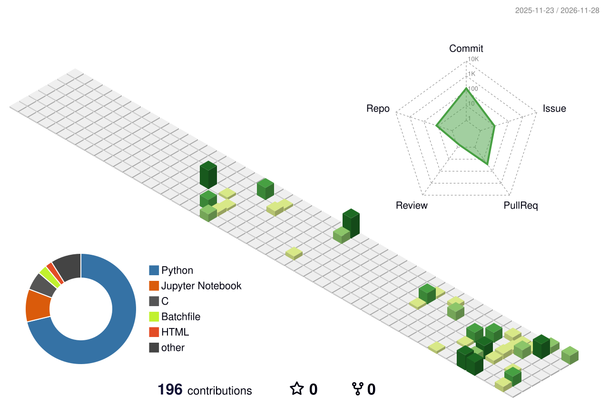

  <h1>C. Harshal Rajesh</h1>
  
<strong>Computer Science · Applied Machine Learning · Linux Systems</strong>

  

    <a href="https://linkedin.com/in/c-harshal-rajesh">LinkedIn</a> ·
    <a href="mailto:harshalprozone@gmail.com">Email</a> ·
    <a href="https://leetcode.com/u/C_Harshal_Rajesh/">LeetCode</a>
  

## About

I’m a B.Tech Computer Science student at **PES University (2024–2028)** with a **9.07 CGPA**. I build software across the stack, from Linux process supervision to machine learning applications. My current interests include natural language processing, semantic search, and methods for checking whether LLM responses are grounded in evidence.

## Selected projects

### [EmoTrace](https://github.com/harshal-prozone/Emotrace)

An emotion-aware dialogue agent that uses DistilBERT to classify emotions and track how they shift across conversation turns.

`Python` · `DistilBERT` · `Hugging Face` · `Flask`

### [OS-Jackfruit](https://github.com/harshal-prozone/OS-Jackfruit)

A lightweight Linux container supervisor that explores namespace isolation, process lifecycle management, and kernel-level memory monitoring.

`C` · `Python` · `Linux`

### [Electronics Store Inventory Management System](https://github.com/harshal-prozone/Electronics-Store-Inventory-Management-System)

An inventory app for electronics components with role-based access, searchable stock, and a transaction history for stock movements.

`Python` · `Flask` · `SQLite`

### [FurniShop](https://github.com/harshal-prozone/furniShop-kivymd-app)

A furniture shopping app with product browsing, cart and order flows, and an admin dashboard.

`Python` · `KivyMD` · `MySQL`

## In progress

- **HalluciTrace** explores whether retrieval and embedding signals can flag potentially unsupported claims in LLM responses.
- **Resume Matcher** explores semantic matching between résumés and job descriptions using sentence embeddings.

## Tools

- **Languages and systems** · Python, C, JavaScript, Linux, Git
- **Web and data** · Flask, React, Node.js, MySQL, SQLite
- **Machine learning** · scikit-learn, Hugging Face, Sentence Transformers

## GitHub activity

<picture>
  <source media="(prefers-color-scheme: dark)" srcset="./profile-3d-contrib/profile-night-green.svg">
  
</picture>

[Contribution snake animation](https://github.com/harshal-prozone/harshal-prozone/blob/output/github-contribution-grid-snake.svg) · [Browse all repositories](https://github.com/harshal-prozone?tab=repositories)
